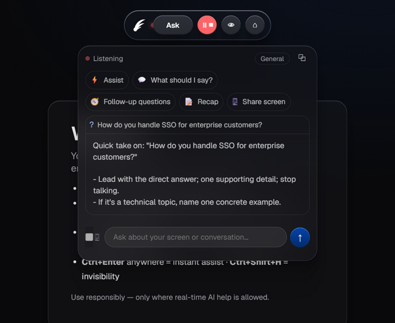
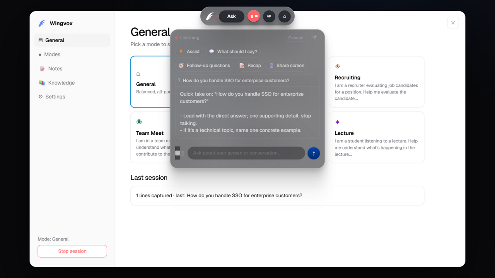
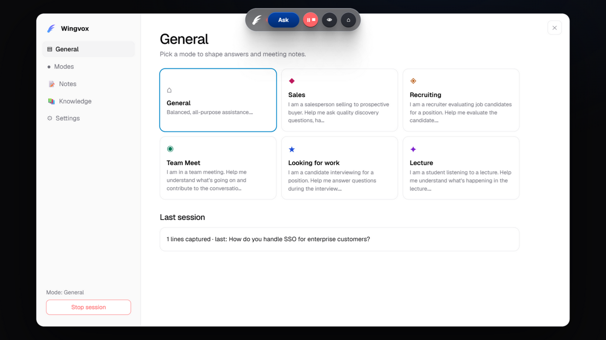

# Wingvox

> **⚠ Reversed-engineered beta** — Wingvox is a reverse-engineered clone built for learning and hackathon purposes. It is **still under development and testing**: expect rough edges, breaking changes, and features that may not work in every browser or OS version.

**Wingvox** — *wing* (your wingman; the theater wings where the helper waits offstage) + *vox* (voice) — **"the voice at your side on every call."** A live meeting copilot that runs entirely in your browser: it transcribes the conversation live, detects questions/objections/key terms, and answers them on the spot — plus screen awareness, personas, meeting notes, and a local knowledge base. The name was coined for this project; as of 2026-10-24, searches found no existing product using it.

The UI is a replica of Cluely's shipped design: colors, gradients, shadows, chips, and the pill → chat → dashboard flow are taken from their actual code (see **[EVIDENCE.md](EVIDENCE.md)** §0, findings F1–F8). The prompts, personas, hotkey map, and free-tier limits in this project come from that same shipped build.

## Screenshots

The glass overlay — listening, answering a detected question mid-conversation:



Floating above other apps (the dashboard here), and the dashboard itself:





## Architecture

The renderer runs in a browser tab or in the desktop shell; the shell's window is excluded from screen capture, so shares and recordings never see it. Interactive version: [diagrams/wingvox-architecture.html](diagrams/wingvox-architecture.html).



## Run it

No build step, no server, no dependencies:

```
cd "C:\Users\thaku\hackathon-projects\Smart Cheat"   # folder: rename it to "Wingvox" if you like — the app is name-agnostic
python -m http.server 8000
```

> To rename the folder itself: stop the dev server, close the editor workspace, then `mv "...\Smart Cheat" "...\Wingvox"`. Nothing in the app hardcodes the folder name.

Then open http://localhost:8000 in **Chrome or Edge** (needed for Web Speech, PiP, and screen capture).

## Desktop mode — invisible to screen share (the Cluely trick)

In a plain browser tab, screen shares will always see the page — that's a browser limitation. The real feature needs the desktop shell (this is exactly what Cluely ships: `setContentProtection` on every window — see EVIDENCE.md F1/F9):

```
cd desktop
npm install        # once, downloads Electron
npm start          # needs the web app served at http://localhost:8000
```

You get a transparent, frameless, always-on-top glass window running the full app, with **capture protection ON by default**: on Windows it sets `SetWindowDisplayAffinity(WDA_EXCLUDEFROMCAPTURE)`, on macOS `NSWindowSharingNone`. Screen shares, recordings, and screenshots (Zoom/Meet/Teams + print-screen APIs) never see the window — you see it normally.

- **Eye button** = toggle capture protection (Cluely's "Make Invisible"); a 🛡 badge in the panel shows the live state.
- **`Ctrl+\` / `Ctrl+Shift+\`** — Cluely's shipped global hotkeys: toggle invisibility / toggle session (work even when the window isn't focused).
- **Dynamic sizing** — the window hugs its visible content: pill-only when collapsed (~250×64), pill + panel when Ask is open, large and centered when the Dashboard is open. Nothing invisible blocks clicks behind it, and dragging the pill moves the whole window.
- **It remembers where you put it** — the pill position persists across restarts (`%APPDATA%/Wingvox/wingvox-anchor.json`), so drag it away from your browser tabs once and it stays there.
- **Taskbar presence** — Wingvox shows a taskbar icon (quit it from there); it is invisible only to screen *captures*, never to you.
- **`Ctrl+Shift+H` is global in desktop mode** — fully hides the window (nothing left blocking clicks) and brings it back, even when the window is already hidden.
- Verified in-repo: `WINGVOX_VERIFY=1 npm start` captures the screen twice via `desktopCapturer` (the same path conferencing apps use) — with protection ON the window is absent from the frame, with it OFF the window appears (`desktop/verify-ON.png` / `verify-OFF.png`).
- macOS also gets `vibrancy: under-window`, so the glass panels genuinely frost the desktop behind them. On Windows the panels are translucent without desktop-blur (a Windows/Electron limitation).

The **floating meeting window** (control pill + chat panel) uses a **glassmorphism theme** — frosted translucent surfaces (`backdrop-filter: blur+saturate`) over Cluely's oklch palette, hairline light borders, and inner top highlights. The Dashboard deliberately keeps the solid light theme from Cluely's dashboard tokens.

## The flow (same as Cluely's)

1. **Control pill** — a translucent rounded pill floats at the top of the page: white logo, status dot, blue-gradient **Ask** button, mic (session) button, eye (invisibility) button, dashboard button. Drag it anywhere; double-click it to open the Dashboard.
2. **Ask** ⇄ **Hide** — clicking Ask opens the chat panel beneath the pill: quick-action chips (Assist / What should I say? / Follow-up questions / Recap / Share screen), Live Insight chips, and the ask bar. The Ask button flips to a dark **Hide** with a shimmer while a response is running — the exact behavior of their shipped control bar.
3. **Session** — the mic button starts/stops a live session (red pulsing dot). Finalized speech lines are checked for questions, objections, and key terms; hits appear as **rounded-full insight chips** (`?`/`!`/`#` icons) that expand inline into answers. `Ctrl+Shift+L` does the same. Demo: Dashboard → General → *Play demo conversation*.
4. **Dashboard** — a separate light-themed window (like theirs): sidebar (General / Modes / **Transcript** / Notes / Knowledge / Settings), `text-[30px] tracking-tight` headings, persona cards with their color coding (Sales=pink, Recruiting=amber, Team Meet=emerald, Looking for work=blue, Lecture=purple), notes generation per-persona + Markdown export + pre-call brief, knowledge base with the shipped 3-file/20MB limits, and settings.

### Hearing the other party (system-audio loopback)

Mic mode (default) transcribes your microphone keylessly via Web Speech. **System-audio mode** hears the meeting — the other party too: Settings → *Audio source* → *System audio*, then start a session and pick a source with **"Share audio"** enabled. Wingvox gates 7-second chunks with an RMS speech detector (its stand-in for Cluely's Silero VAD) and transcribes each through an OpenAI-compatible `/audio/transcriptions` endpoint. This mode needs an API key; without one it refuses to start and falls back gracefully.

### Streaming, persistence, transcript

- **Streaming** — with a real endpoint, answers stream token-by-token (SSE); mock mode simulates the same reveal.
- **Sessions survive reloads** — transcript, insight cards, and notes persist to `localStorage` (`wingvox.session.v1`, debounced) and come back on the next launch.
- **Transcript view** — Dashboard → Transcript lists every finalized line with timestamps, exports `.txt`, and *Clear session* wipes the snapshot.

## Tests & CI

Zero-dependency test suite (`npm test`, no framework, in-process): trigger detection cases, knowledge-base limits + retrieval, shipped prompts/personas + mock streaming, settings migration + session snapshot round-trip. `npm run check` syntax-checks every module. GitHub Actions runs both on every push/PR (`.github/workflows/ci.yml`).

## Packaging

`cd desktop && npm install && npm run dist` builds installers with electron-builder (Windows NSIS + portable, macOS DMG, Linux AppImage). `npm run dist:dir` produces an unpacked build — validated on Windows (`dist/win-unpacked/Wingvox.exe`). Signed Windows installers need admin or Developer Mode for electron-builder's winCodeSign cache step. Note: the packaged app still expects the web app at `http://localhost:8000` (set `WINGVOX_URL` to point it elsewhere).

## Deploy the web app

The web app is fully static — any static host works. GitHub Pages: push the repo, enable Pages on the `main` branch, done. (Speech recognition, screen sharing, and PiP need Chrome/Edge over http(s), which Pages provides.)

## License

MIT — see [LICENSE](LICENSE). The Wingvox logo is © 2026 Piyush Anand ([assets/logo/LOGO-COPYRIGHT.md](assets/logo/LOGO-COPYRIGHT.md)).
5. **Invisibility** — the eye button (or `Ctrl+Shift+H`) collapses everything to a tiny dot; `Ctrl+Shift+P` floats the pill+panel above other apps via Document Picture-in-Picture.

### Hotkeys

| Action | Cluely (shipped) | Here |
|---|---|---|
| Ask / Assist | `Ctrl+Enter` | `Ctrl+Enter` |
| Toggle chat | Ask/Hide button | Ask button |
| Toggle visibility | `Ctrl+\` | `Ctrl+Shift+H` (eye button) |
| Session start/stop | mic button | mic button / `Ctrl+Shift+L` |
| Say what I should say | — | `Ctrl+Shift+S` |
| Follow-up questions | — | `Ctrl+Shift+F` |
| Recap | — | `Ctrl+Shift+R` |
| Knowledge | — | `Ctrl+Shift+K` |
| Float above apps | — | `Ctrl+Shift+P` |
| Move overlay | `Ctrl+arrows` | drag pill / `Alt+arrows` |
| Dashboard | double-click pill | double-click pill / `⌂` button |

## Feature parity vs Cluely

| Feature | Cluely | Wingvox |
|---|---|---|
| Control pill (exact gradients, ring, shadows) | ✅ | ✅ same values |
| Chat panel with insight chips + quick actions | ✅ | ✅ same classes/colors |
| Light dashboard with sidebar + modes | ✅ | ✅ same tokens |
| Geist typography, oklch palette | ✅ | ✅ |
| Live transcription (20 locales) | sox/audiotee + Silero VAD + server ASR | Web Speech (mic) + loopback STT (system) |
| Streaming token-by-token answers | ✅ | ✅ SSE (+ simulated in mock) |
| Session history / transcript | ✅ | ✅ dashboard Transcript view + .txt export |
| Live Insights (question/objection/term detection → auto-answer) | server-side keyword detection | client-side `detectTrigger()` |
| Assist / Say / Follow-ups / Recap — same shipped prompts | ✅ | ✅ verbatim from their bundle |
| Modes with per-mode note sections | ✅ | ✅ same personas + sections |
| Screen awareness ("Based on what's on my screen…") | desktopCapturer | getDisplayMedia → vision frames |
| Knowledge base (RAG), 3 files / 20 MB free | ✅ | ✅ same limits, local only |
| Never joins the call, no bots | ✅ | ✅ |
| Overlay invisible to screen share | `setContentProtection` (OS window flag) | ✅ **in desktop mode** (`desktop/` Electron shell, A/B verified); browser tab stays visible |
| Hears the other party (system audio) | audiotee (macOS) / sox loopback (Win) + server ASR | ✅ system-audio mode: loopback + RMS gate + `/audio/transcriptions` (needs key); mic mode keyless |
| Server accounts, CRM sync, teams | ✅ | ❌ (local-only by design) |

## Files

```
index.html        control pill + chat panel + dashboard
css/style.css     glassmorphism over Cluely's design system (extracted oklch tokens)
js/store.js       persisted settings + session state
js/kb.js          knowledge base + retrieval (RAG-lite)
js/llm.js         prompts/personas engine + OpenAI-compatible client + mock engine
js/speech.js      Web Speech transcription, 20 languages
js/screen.js      screen frames for vision
js/app.js         Cluely flow wiring: pill/panel/dashboard, insights, actions, stealth, PiP, hotkeys
desktop/          Electron shell: transparent always-on-top window + capture protection (F9)
diagrams/         architecture diagram (interactive HTML + exported SVG)
assets/           logo marks + app screenshots used in this README
EVIDENCE.md       every Cluely claim + shipped-code findings (F1–F9), with sources
assets/logo/      original Wingvox logo (© 2026, see assets/logo/LOGO-COPYRIGHT.md) — SVG/PNG + favicon
```

## Notes & ethics

Everything stays on your machine: no account, no server, keys live in `localStorage`. Real Cluely markets itself for contexts (interviews, sales calls) where covert AI assistance may violate rules or law — the independent testing in EVIDENCE.md also shows it *is* detectable by proctoring platforms. Use this clone only where real-time AI help is permitted.
